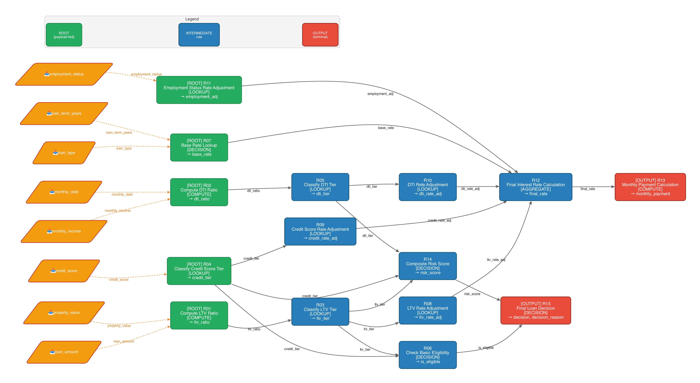
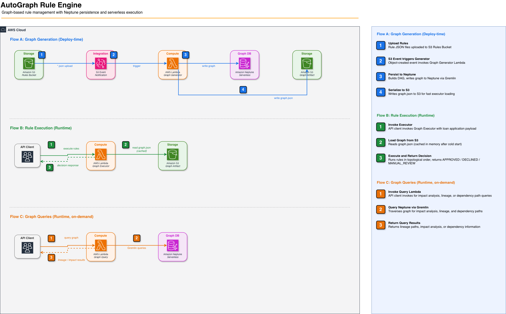

# AutoGraph Rule Engine

A graph-based rule management system that takes rule definitions as JSON, automatically discovers dependencies between rules by matching `outputs` → `inputs`, builds a DAG, and executes rules in topological order.



---

## Architecture



| Concern | Where | When |
|---------|-------|------|
| Graph building + validation | Graph Generator Lambda | On rule upload to S3 |
| Graph persistence + querying | Neptune | Always available |
| Rule execution | Graph Executor Lambda | Per request (~0.5ms warm) |
| Impact analysis + dependency tracing | Graph Query Lambda | On demand (reads Neptune) |

---

## How It Works

**Deploy-time (graph building):**
1. Upload rule JSON files to the **Rules S3 bucket**
2. S3 event triggers the **Graph Generator Lambda** (in VPC, can reach Neptune)
3. Generator builds the DAG, writes to **Neptune** (querying) and **S3** (serialized graph)

**Runtime (two independent paths):**
- **Rule execution:** Graph Executor Lambda reads graph from S3, caches it, executes rules against payloads
- **Graph queries:** Graph Query Lambda reads from Neptune for impact analysis and dependency tracing

Dependencies are automatically inferred — if Rule A outputs `ltv_ratio` and Rule B inputs `ltv_ratio`, an edge A → B is created. No manual wiring.

---

## Deploy

### AWS Account & Region

CDK deploys to whichever AWS account your credentials point to. Configure before deploying:

```bash
# Option 1: AWS profile
export AWS_PROFILE=my-account

# Option 2: Environment variables
export AWS_ACCESS_KEY_ID=...
export AWS_SECRET_ACCESS_KEY=...
export AWS_REGION=us-west-2
```

No code changes needed — CDK picks up the active credentials automatically.

---

```bash
make install    # creates venv, installs deps + CDK
make deploy     # builds Lambda layer + deploys stack
```

Or manually:

```bash
# Setup
python3 -m venv .venv
.venv/bin/pip install -e ".[dev]"
.venv/bin/pip install aws-cdk-lib constructs

# Build Lambda dependency layer
rm -rf build/lambda_deps && mkdir -p build/lambda_deps/python
.venv/bin/pip install pydantic simpleeval networkx gremlinpython \
    --target build/lambda_deps/python \
    --platform manylinux2014_x86_64 \
    --implementation cp \
    --python-version 3.13 \
    --only-binary=:all:

# Deploy
cdk deploy
```

After deploy:

```bash
make publish-rules   # uploads rule JSONs to S3 (triggers graph build)
make invoke          # invokes executor Lambda with sample payload
make query Q=stats   # queries Neptune for graph statistics
```

Tear down:

```bash
make destroy    # or: cdk destroy
```

### What gets created

| Resource | Purpose |
|----------|---------|
| VPC | Network isolation for Neptune |
| Neptune Serverless | Graph persistence, impact analysis, dependency tracing |
| S3 (Rules) | Rule JSON source files, triggers generator on upload |
| S3 (Graph) | Serialized graph artifact for executor |
| Graph Generator Lambda | Builds graph → Neptune + S3 |
| Graph Executor Lambda | Loads graph from S3, executes rules |
| Graph Query Lambda | Reads from Neptune for impact analysis, dependency tracing, paths |
| CloudWatch Log Groups | 14-day retention logs for all Lambdas |

---

## Rule Execution

```bash
make invoke
```

Or manually with different applicant profiles:

```bash
# Invoke — APPROVED (good applicant)
aws lambda invoke \
    --function-name autograph-graph-executor \
    --cli-binary-format raw-in-base64-out \
    --payload '{
      "payload": {
        "loan_amount": 280000,
        "property_value": 350000,
        "credit_score": 740,
        "monthly_debt": 1500,
        "monthly_income": 8000,
        "loan_type": "CONVENTIONAL",
        "loan_term_years": 30,
        "employment_status": "FULL_TIME"
      }
    }' response.json && cat response.json | python3 -m json.tool

# Invoke — DECLINED (risky applicant)
aws lambda invoke \
    --function-name autograph-graph-executor \
    --cli-binary-format raw-in-base64-out \
    --payload '{
      "payload": {
        "loan_amount": 320000,
        "property_value": 330000,
        "credit_score": 540,
        "monthly_debt": 3500,
        "monthly_income": 6000,
        "loan_type": "CONVENTIONAL",
        "loan_term_years": 30,
        "employment_status": "PART_TIME"
      }
    }' response.json && cat response.json | python3 -m json.tool

# Invoke — MANUAL_REVIEW (borderline applicant)
aws lambda invoke \
    --function-name autograph-graph-executor \
    --cli-binary-format raw-in-base64-out \
    --payload '{
      "payload": {
        "loan_amount": 310000,
        "property_value": 350000,
        "credit_score": 620,
        "monthly_debt": 2800,
        "monthly_income": 6000,
        "loan_type": "FHA",
        "loan_term_years": 30,
        "employment_status": "SELF_EMPLOYED"
      }
    }' response.json && cat response.json | python3 -m json.tool
```

---

## Neptune Graph Queries

The **Graph Query Lambda** reads from Neptune for impact analysis, dependency tracing, and path finding.

```bash
# Graph statistics
make query Q=stats
# → 15 rules, 18 edges, roots: [R01, R02, R04, R07, R11], leaves: [R13, R15]

# Impact analysis: what breaks if R01 (LTV calculation) changes?
make query Q=impact RULE=R01
# → rules_affected_if_changed: [R03, R06, R08, R12, R13, R14, R15] (7 rules impacted)

# Dependency tracing: what does R15 (final decision) depend on?
make query Q=ancestors RULE=R15
# → ancestors: [R01, R02, R03, R04, R05, R06, R14] (7 upstream rules)

# Descendants: what rules consume R04's output?
make query Q=descendants RULE=R04
# → descendants: [R06, R09, R12, R13, R14, R15] (6 downstream rules)

# Path analysis: how does LTV flow to monthly_payment?
make query Q=paths FROM=R01 TO=R13
# → path: R01 → R03 → R08 → R12 → R13

# Single rule metadata
make query Q=rule RULE=R12
# → name: "Final Interest Rate Calculation", inputs: [base_rate, ltv_rate_adj, ...], outputs: [final_rate]

# All rules
make query Q=rules
```

Or manually:

```bash
# Graph statistics
aws lambda invoke \
    --function-name autograph-graph-query \
    --cli-binary-format raw-in-base64-out \
    --payload '{"query":"stats"}' \
    response.json && cat response.json | python3 -m json.tool

# Impact analysis
aws lambda invoke \
    --function-name autograph-graph-query \
    --cli-binary-format raw-in-base64-out \
    --payload '{"query":"impact","rule_id":"R01"}' \
    response.json && cat response.json | python3 -m json.tool

# Dependency tracing (ancestors)
aws lambda invoke \
    --function-name autograph-graph-query \
    --cli-binary-format raw-in-base64-out \
    --payload '{"query":"ancestors","rule_id":"R15"}' \
    response.json && cat response.json | python3 -m json.tool

# Descendants
aws lambda invoke \
    --function-name autograph-graph-query \
    --cli-binary-format raw-in-base64-out \
    --payload '{"query":"descendants","rule_id":"R04"}' \
    response.json && cat response.json | python3 -m json.tool

# Path analysis
aws lambda invoke \
    --function-name autograph-graph-query \
    --cli-binary-format raw-in-base64-out \
    --payload '{"query":"paths","source_rule_id":"R01","target_rule_id":"R13"}' \
    response.json && cat response.json | python3 -m json.tool

# Single rule metadata
aws lambda invoke \
    --function-name autograph-graph-query \
    --cli-binary-format raw-in-base64-out \
    --payload '{"query":"rule","rule_id":"R12"}' \
    response.json && cat response.json | python3 -m json.tool

# All rules
aws lambda invoke \
    --function-name autograph-graph-query \
    --cli-binary-format raw-in-base64-out \
    --payload '{"query":"rules"}' \
    response.json && cat response.json | python3 -m json.tool
```

Use cases:
- **Change impact analysis** — before modifying a rule, see what downstream rules are affected
- **Dependency tracing** — trace how a payload field flows through the rule graph
- **Debugging** — find all paths between two rules to understand execution flow

### Why execute from S3, not Neptune?

The executor loads a serialized graph from S3 (~0.5ms warm) rather than querying Neptune at runtime. This is the right tradeoff when:
- Rules change infrequently (deploy-time graph build is acceptable)
- Execution latency matters (sub-millisecond vs. network round-trips to Neptune)
- Rule sets are small enough to fit in Lambda memory

Executing directly from Neptune would make sense when:
- Rule sets are too large to serialize into a single S3 object
- Rules change frequently and you need real-time graph updates without redeployment
- Execution requires dynamic subgraph selection (e.g., only execute rules relevant to a specific product line)
- Multiple services need consistent graph state without S3 cache invalidation

---

## Rule JSON Schema

```json
{
  "rule_id": "R01",
  "name": "Compute Loan-to-Value Ratio",
  "inputs": ["loan_amount", "property_value"],
  "outputs": ["ltv_ratio"],
  "action": {
    "type": "compute",
    "expression": "loan_amount / property_value"
  }
}
```

Action types: `compute`, `lookup`, `aggregate`, `decision`

---

## Sample Rules (Loan Pricing)

| Rule | Inputs | Outputs |
|------|--------|---------|
| R01 | loan_amount, property_value | ltv_ratio |
| R02 | monthly_debt, monthly_income | dti_ratio |
| R03 | ltv_ratio | ltv_category |
| R04 | credit_score | credit_category |
| R05 | dti_ratio | dti_category |
| R06 | ltv_category, credit_category, dti_category | is_eligible |
| R07 | loan_type, loan_term_years | base_rate |
| R08–R11 | categories, employment_status | rate adjustments |
| R12 | all adjustments | final_rate |
| R13 | loan_amount, final_rate, loan_term_years | monthly_payment |
| R14 | ltv_ratio, dti_ratio, credit_score | risk_score |
| R15 | is_eligible, risk_score, final_rate | decision |

---

## Local Development

```bash
make install        # venv + deps
make test           # run tests
make visualize      # regenerate rule_graph.png
```

Or manually:

```bash
python3 -m venv .venv
.venv/bin/pip install -e ".[dev]"
.venv/bin/pytest tests/ -v
.venv/bin/python scripts/visualize_graph.py
```

Run the engine locally (no AWS needed):

```bash
.venv/bin/python scripts/quickstart.py
```

`quickstart.py` loads rules, builds the graph, validates it, then executes against three sample applicants (APPROVED, DECLINED, MANUAL_REVIEW) and tests cycle detection.

> **Note:** `make visualize` requires the [Graphviz](https://graphviz.org/) `dot` binary installed on your system (`brew install graphviz` on macOS, `apt install graphviz` on Linux). The Python package is installed via pip, but the renderer is a system dependency. If not installed, the script saves the `.dot` source and prints instructions.

---

## Project Structure

```
src/autograph_rule_engine/
├── core/                        # parser, graph_builder, validator, executor, models
├── backends/                    # local_backend, neptune_backend
├── compute/
│   ├── graph_executor_handler.py  # Graph Executor Lambda
│   ├── graph_generator_handler.py # Graph Generator Lambda
│   └── graph_query_handler.py     # Graph Query Lambda (Neptune reads)
└── deploy/
    └── graph_publisher.py       # CLI publisher (local use)

infra/
├── app.py                       # CDK app entry point
└── stack.py                     # CDK stack (VPC, Neptune, S3, Lambdas)

rules/loan_pricing/              # 15 sample rule JSONs
scripts/
├── quickstart.py                # Local end-to-end demo
├── build_query_payload.py       # Helper for make query
└── visualize_graph.py           # Generate rule_graph.png
tests/                           # pytest tests
Makefile                         # Build, deploy, test automation
```

---

## Security

See [CONTRIBUTING](CONTRIBUTING.md#security-issue-notifications) for more information.

---

## Performance

| Metric | Cold Start | Warm |
|--------|-----------|------|
| Graph load (S3) | ~3s | 0ms (cached) |
| Rule execution (15 rules) | ~1ms | ~0.5ms |


## License

This library is licensed under the MIT-0 License. See the LICENSE file.
